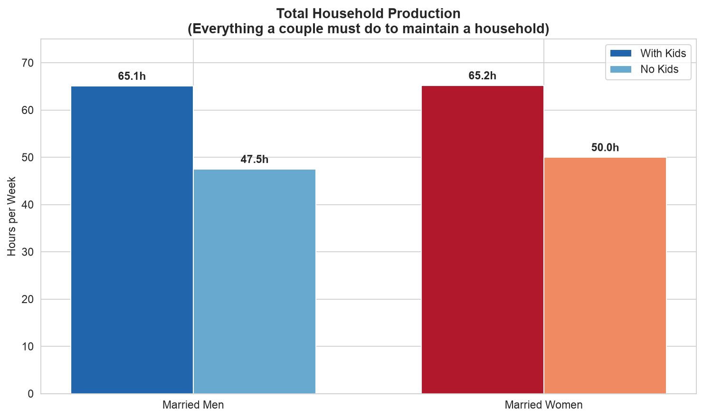
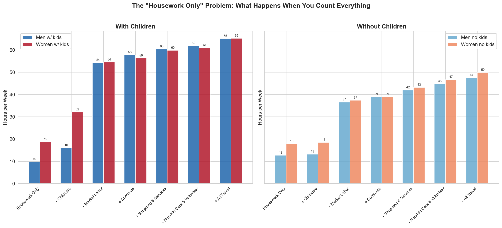
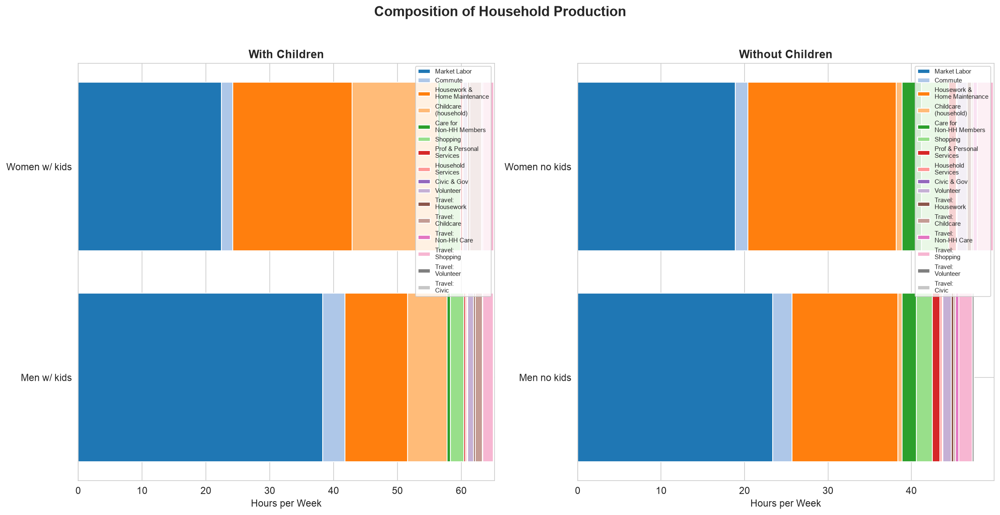
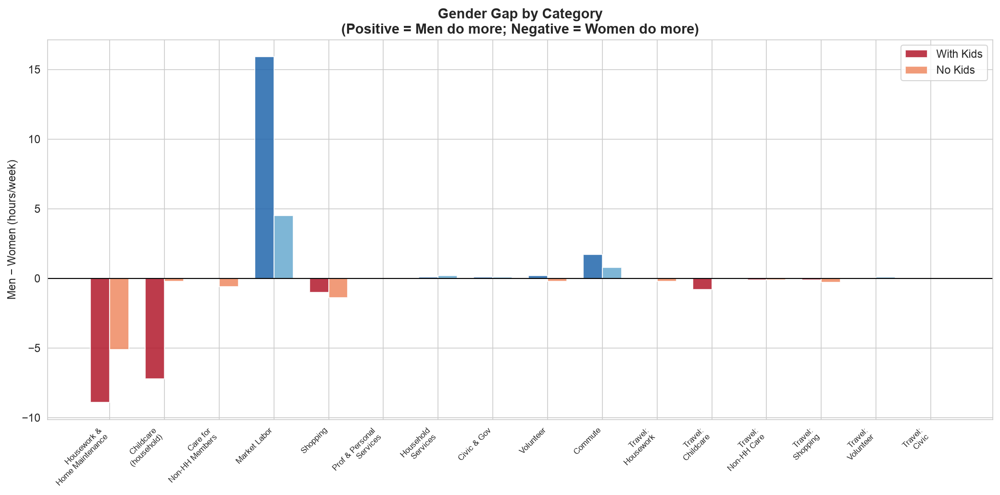
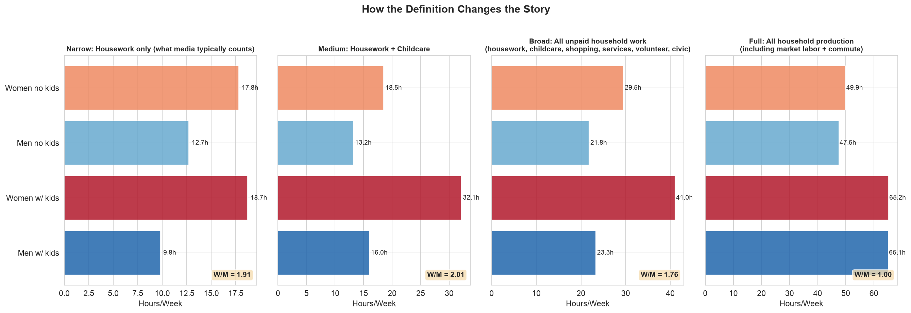
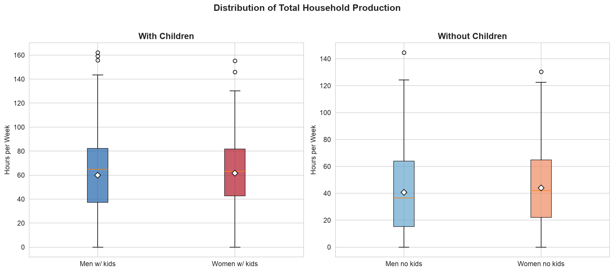

You've seen the headline: *"Women still do more housework than men."* The
data behind it is real — married women do spend more time cleaning, cooking,
and doing laundry than married men. But the framing leaves out most of what
men actually do around the house. A couple cannot maintain a household on
housework alone. Someone has to earn the income that pays for the house.
Someone has to commute to that job. Someone has to mow the lawn, repair the
sprinklers, coach the little league team, drive the kids to after-school
programs, and do the grocery shopping.

This analysis uses the American Time Use Survey (ATUS) — a large,
nationally representative time-diary survey conducted by the Bureau of Labor
Statistics — to compare married men and women on **total household
production**: everything a couple is reasonably required to do to maintain a
household, with a special focus on couples with children.

## What counts as household production?

The ATUS tracks how Americans spend every minute of a 24-hour day, using a
detailed 6-digit activity coding lexicon (over 400 distinct activities). We
mapped these activities into the following categories — everything a couple
must do to keep a household running:

| Category | What's in it |
|----------|-------------|
| **Housework & home maintenance** | Interior cleaning, laundry, cooking, food prep & cleanup, interior repairs & decoration, **exterior cleaning/repairs, lawn care, landscaping, sprinkler repair**, ponds/pools, pet care, vehicle repair, appliance/tool repair, household management & finances |
| **Childcare (household)** | Physical care, reading, playing, arts & crafts, sports, **attending kids' events, picking up/dropping off (driving kids to school & activities)**, homework help, school conferences, homeschooling, medical care, plus caring for household adults |
| **Care for non-household members** | Caring for non-household children (**coaching little league, helping with homework, driving to activities**), helping non-household adults |
| **Market labor** | Work at main job, other jobs, work-related activities, income-generating hobbies, job search & interviewing |
| **Commute** | All travel related to working, work activities, and job search |
| **Shopping** | Groceries, gas, food purchases, general shopping, comparison shopping |
| **Professional & personal services** | Banking, financial services, legal services, medical services, paid childcare, personal care, veterinary services |
| **Household services** | Using repair, maintenance, lawn/garden, vehicle, and cleaning services |
| **Civic & government** | Civic obligations, government services, licenses/fees/taxes |
| **Volunteering** | **Coaching, mentoring, teaching, leading**, building houses/structures, indoor/outdoor maintenance & cleanup, food prep, fundraising, public health & safety, attending meetings |
| **Travel for all of the above** | Travel to shopping, childcare, volunteering, civic activities — all the driving that maintaining a household requires |

### What's excluded and why

Personal care (sleeping, grooming), eating and drinking, socializing and
leisure, sports and recreation, religious activities, education, and phone
calls are excluded. These are things people do for themselves or for
enjoyment — they are not required labor for household maintenance.

### Why include market labor and commute?

This is the key analytical choice. A couple cannot maintain a household
without income. The hours spent earning that income — including the commute —
are hours not available for other household production. If one partner works
40 hours a week plus 5 hours commuting, those 45 hours are their contribution
to household production, just as the other partner's 15 hours of cooking and
20 hours of childcare are theirs. Both are essential. Both are labor the
household requires.

### Why include volunteering and community work?

Coaching a kid's little league team, helping at after-school programs,
organizing community events — these are things parents (especially fathers)
do as part of maintaining a household with children. They substitute for
paid services and are required labor for the household. The ATUS
volunteering category (tier 1 code 15) includes teaching, leading,
counseling, mentoring, building, maintenance, food preparation, and
organizing — all the things that keep a family and community running.

## Data and method

**Data**: ATUS 2018, the most recent pre-pandemic year with full data
available. The summary file contains 9,593 respondents, each recording
every activity during one diary day. We filter to **4,571 married
respondents** (spouse present in the household) and split them into four
groups:

| Group | Sample size |
|-------|------------:|
| Married men with children | 1,170 |
| Married men without children | 1,083 |
| Married women with children | 1,201 |
| Married women without children | 1,117 |

"Has children" means any household child under 18. All means are weighted
using ATUS final weights (`tufinlwgt`) to be nationally representative. The
ATUS diary measures a single day; we convert to weekly by multiplying by 7.
BLS oversamples weekends to account for day-of-week variation.

The full extraction and analysis code lives in two Jupyter notebooks in this
directory:
[`01_extraction.ipynb`](https://github.com/ericbusboom/explainers/blob/master/content/posts/household-production/01_extraction.ipynb)
(data download, schema parsing, activity-code mapping, CSV output) and
[`02_analysis.ipynb`](https://github.com/ericbusboom/explainers/blob/master/content/posts/household-production/02_analysis.ipynb)
(charts, tables, and findings). The extracted data is in
[`atus_extracted.csv`](https://github.com/ericbusboom/explainers/blob/master/content/posts/household-production/atus_extracted.csv).

## The story you've heard: housework only

If you count only what the ATUS calls "household activities" — interior
cleaning, laundry, cooking, food prep & cleanup, interior & exterior
maintenance, lawn & garden care, pet care, vehicle & appliance repair, and
household management — here's what married couples with children look like:

| | Men | Women | Women ÷ Men |
|---|----:|------:|------------:|
| Housework & home maintenance | 9.8 hrs/wk | 18.7 hrs/wk | **1.9×** |

Women do almost twice as much housework as men. This is the number behind
most "men don't share the housework" stories. It is accurate — but it is
not the whole picture.

## The story you don't hear: everything else

Now add the rest of household production. The chart below shows what happens
as you add categories one at a time — childcare, then market labor, then
commute, then shopping & services, then non-household care & volunteering,
then all travel:

At each step, the ratio of women's time to men's time changes:

| What you count | Men (hrs/wk) | Women (hrs/wk) | Women ÷ Men |
|---------------|----:|------:|------------:|
| Housework only | 9.8 | 18.7 | **1.91×** |
| + Childcare | 16.0 | 32.1 | 2.01× |
| + Market labor | 54.3 | 54.5 | 1.00× |
| + Commute | 57.6 | 51.5 | **0.89×** |
| + Shopping & services | 60.0 | 55.3 | 0.92× |
| + Non-HH care & volunteer & civic | 61.6 | 56.0 | 0.91× |
| + All travel (total household production) | **65.1** | **65.2** | **1.00×** |

Adding childcare makes the gap *wider* — women do more childcare too. But
adding market labor closes the gap entirely, because married men with
children spend 38 hours a week at work plus 3.5 hours commuting, while
married women with children spend 22 hours at work plus 1.8 hours commuting.
Once you count earning the income that pays for the household — including the
commute — the totals converge to **65 hours a week each**, within rounding.

## Where the time goes

The stacked charts below show the composition of household production for
each group. The total bars are the same height — but the colors inside them
are very different.

For couples **with children**, the big blocks are:

- **Men**: market labor (38.3 hrs) + commute (3.5 hrs) = 41.8 hrs, plus
  housework (9.8 hrs) and childcare (6.2 hrs)
- **Women**: market labor (22.4 hrs) + commute (1.8 hrs) = 24.2 hrs, plus
  housework (18.7 hrs) and childcare (13.4 hrs)

For couples **without children**, the pattern is similar but the totals
diverge slightly — men do 47.5 hrs/week, women 50.0 hrs/week — because the
childcare gap drops out and women's housework advantage remains.

## The gender gap, category by category

A positive bar means men spend more time; negative means women do. The
pattern is clear: men dominate market labor and commute; women dominate
housework and childcare. Shopping is roughly equal. Volunteering, services,
and civic participation are small but slightly higher for men.

## Men's share within each category

For couples with children, what percentage of each activity does the man
contribute?

| Activity | Men's share | Men (hrs/wk) | Women (hrs/wk) |
|----------|----------:|----:|----:|
| Market labor | 63% | 38.3 | 22.4 |
| Commute | 67% | 3.5 | 1.8 |
| Housework & home maintenance | 34% | 9.8 | 18.7 |
| Childcare (household) | 31% | 6.2 | 13.4 |
| Shopping | 40% | 2.1 | 3.1 |
| Volunteering | 55% | 0.9 | 0.7 |
| Travel (childcare) | 36% | 1.1 | 1.9 |
| **Total household production** | **50%** | **65.1** | **65.2** |

Men do two-thirds of the market labor and commute; women do two-thirds of
the housework and childcare. These are large differences within categories
— but they cancel out in the total. The question "who does more?" has a
different answer depending on which activity you look at. Only when you
aggregate across all of them does the answer become "neither — they do the
same."

## The narrow vs. broad definition

The chart below makes the definitional point explicit. Four definitions of
"household production," from narrowest to broadest:

- **Narrow (housework only)**: Women do 1.9× what men do. This is the
  number behind most media stories.
- **Medium (housework + childcare)**: Women do 2.0× what men do. Adding
  childcare makes the gap *wider*, not narrower.
- **Broad (all unpaid household work)**: Women do about 15% more than men.
  Even without counting market labor, the gap narrows when you include
  shopping, services, volunteering, and travel.
- **Full (including market labor + commute)**: Parity. Men and women with
  children contribute the same total time to household production.

The ratio in the corner of each panel (W/M) tells the story: 1.91 → 2.01 →
1.17 → 1.00. The definition determines the conclusion.

## Distributions, not just means

The means are nearly identical, but what about the spread? The box plots
below show the distribution of total household production for each group.
The medians (middle line) are close for all four groups, and the spread
overlaps substantially — there are plenty of women who do more than the
median man, and vice versa.

## Takeaways

1. **The "men don't share the housework" story is incomplete.** It is true
   that married women do nearly twice as much housework as married men.
   But housework is only one component of household production. When you
   count everything a couple must do to maintain a household, the total is
   the same.

2. **The difference is in the composition, not the total.** Married men
   with children spend ~65 hours a week on household production; married
   women with children spend ~65 hours a week. Men contribute through
   market labor (38 hrs) and commute (3.5 hrs); women contribute through
   housework (19 hrs) and childcare (13 hrs). Both are essential to
   maintaining a household.

3. **The definition determines the conclusion.** If you count only
   housework, women do 1.9× what men do. If you count housework + childcare,
   it's 2.0×. If you add market labor and commute, it's parity. The choice
   of what to include is not a technical detail — it is the entire
   argument.

4. **This does not mean the division is equal in every household.** These
   are group averages. Individual couples vary, and the distributions
   overlap substantially. Some couples have a more equal division than
   the averages suggest; some have a less equal one.

5. **It also does not mean the current division is optimal.** A couple
   might be better served by a more balanced allocation — for instance, if
   the man reduced his market hours and increased his housework and
   childcare, the woman could increase her market labor. Whether that
   would increase or decrease total household production (or welfare) is a
   separate question this analysis does not answer.

## Limitations

- **Single diary day**: ATUS measures one day per respondent. Weekly
  estimates assume that day is representative, though BLS oversamples
  weekends to mitigate day-of-week bias.
- **Secondary childcare**: ATUS tracks secondary childcare (child present
  while doing other activities) separately. This analysis uses only primary
  activity time. Parents (especially mothers) likely provide more childcare
  as a secondary activity.
- **Within-couple variation**: We compare married men and married women as
  groups, not actual couples. Some couples may have a more equal division
  than the group averages suggest.
- **Market labor ≠ "fun"**: Including market labor in household production
  is defensible because income is essential to maintaining a household.
  However, many people derive satisfaction from their jobs, so not all
  work hours are "burden." The same is true of some childcare and
  volunteering.
- **Pre-pandemic data**: ATUS 2018 is the most recent pre-pandemic year.
  Work-from-home has increased since 2020, which may have shifted the
  commute and market labor categories.

## Sources

- [Bureau of Labor Statistics — American Time Use Survey](https://www.bls.gov/tus/)
- [ATUS 2018 Coding Lexicon (PDF)](https://www.bls.gov/tus/lexiconwex2018.pdf)
- [ATUS User's Guide (PDF)](https://www.bls.gov/tus/atususersguide.pdf)
- [ATUS Data Files](https://www.bls.gov/tus/datafiles.htm) (BLS blocks
  automated downloads; this analysis uses a
  [GitHub mirror](https://github.com/changyaochen/atus-2018) of the same
  files)

---

*The analysis above is generated by
[`01_extraction.ipynb`](https://github.com/ericbusboom/explainers/blob/master/content/posts/household-production/01_extraction.ipynb)
(data extraction) and
[`02_analysis.ipynb`](https://github.com/ericbusboom/explainers/blob/master/content/posts/household-production/02_analysis.ipynb)
(charts and tables), with the extracted data in
[`atus_extracted.csv`](https://github.com/ericbusboom/explainers/blob/master/content/posts/household-production/atus_extracted.csv).
View on GitHub to inspect or run.*
